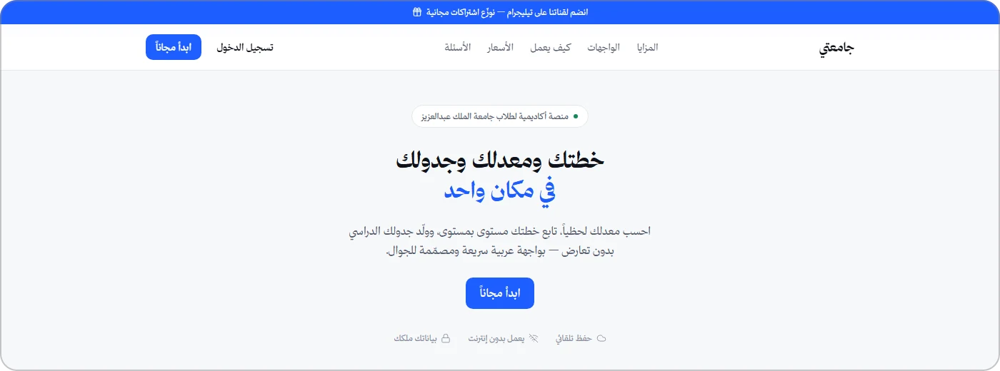
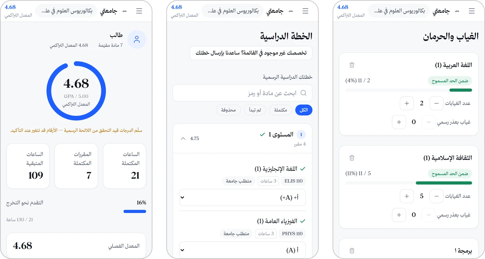

# Jam3ty (جامعتي)

**An Arabic-first academic toolkit for King Abdulaziz University students: GPA, study plan, absences and schedule in one place.**

<a href="https://jam3ty.pages.dev"></a>

## The problem

KAU students track their GPA in spreadsheets, check their study plan in scattered PDFs, and count absences by hand. A miscount can cost them a course (حرمان, denial at 25% absence). None of the existing tools are Arabic-first or built for the phone, where students actually are.

## The solution

A mobile-first, right-to-left PWA that works offline and installs like an app:

- **Live GPA calculator.** Term and cumulative GPA update as you enter grades, with a configurable grade scale and retake policy.
- **Verified study plans.** 87 programmes ingested from KAU's own course registry, including prerequisites and elective groups.
- **Absence (حرمان) tracker.** Each course is measured against the 25% limit, and you can import your current level's courses in one tap.
- **Schedule generator.** Builds clash-free timetables, alongside about 15 other student tools.
- **Freemium.** Premium tools unlock with an activation code bought through Salla checkout.

## Key results

- **240 sign-ups** and **73 weekly active users**.
- Driven by **2 days of organic TikTok/Snapchat content**, with **zero ad spend**.
- Launched **August 2026**.

## How it works

```
Student's phone (PWA, works offline)
   │
   ├── Domain engines (GPA · prerequisites · electives · absence · schedule)  ← pure TypeScript, unit-tested
   ├── Local-first storage (IndexedDB via Dexie)
   │        │  sync
   │        ▼
   │   Supabase (Auth + Postgres, Row-Level Security on every table)
   │
   └── Premium unlock:
         Salla checkout → activation code → Cloudflare Worker (/redeem, /verify) + D1
```

## Tech stack

React · TypeScript · Vite · Tailwind CSS · Dexie (IndexedDB) · Supabase (Auth, Postgres, RLS) · Cloudflare Pages, Workers & D1 · Vitest · Playwright

## Screenshots



*Dashboard, study plan and absence tracker, shown with demo data.*

## Status

🟢 **Live:** [jam3ty.pages.dev](https://jam3ty.pages.dev)

---

Source code is private and available on request. More about me: [Abdullah-Albariqi](https://github.com/Abdullah-Albariqi)
